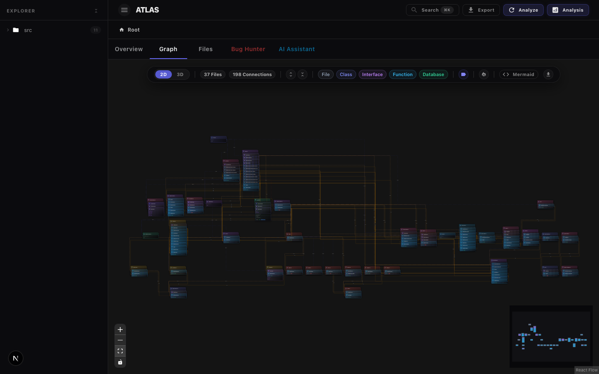
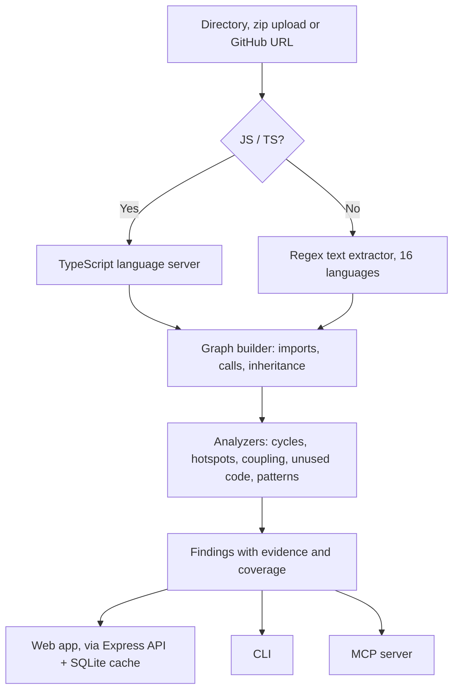

# Atlas

**See how a codebase fits together, and get the evidence behind every claim.**

[](https://github.com/Abhay1006/Reverse-Architect/actions/workflows/ci.yml)
[](https://www.npmjs.com/package/reverse-architect)
[](docs/mcp.md)
[](LICENSE)

Atlas parses a repository, builds its dependency graph, and reports:
- **circular dependencies**;
- **hotspots** (complex code that many things depend on);
- **highly coupled modules**;
- **possibly unused code**;
- **design patterns**.

Each finding says what was observed, what was inferred from that, and what the analysis could not see.

Use it three ways:

| | |
|---|---|
| **Web app** | An interactive 2D/3D graph with code peek, search, a bug hunter and an AI assistant |
| **CLI** | `npx reverse-architect cycles .`: readable output or JSON, with a CI exit code |
| **MCP server** | Lets Claude Code, Cursor, Codex and other agents ask architecture questions instead of reading every file |



---

## Quick start

**From the terminal.** No install needed; Node.js 20.12 or later:

```bash
npx reverse-architect analyze .                      # overview of the current project
npx reverse-architect cycles .                       # circular dependencies, with evidence
npx reverse-architect deps . src/app.ts --dependents # what breaks if I change this?
npx reverse-architect analyze https://github.com/expressjs/express
```

**For your coding agent:**

```bash
claude mcp add reverse-architect -- npx -y reverse-architect mcp
```

Then ask, for example: *"Use reverse-architect to find the circular dependencies in this project and tell me which to break first."* Setup for other agents is in [docs/mcp.md](docs/mcp.md).

**The web app**, from a clone of this repository:

```bash
npm install
npm run dev        # API on :4000, web app on http://localhost:3000
```

Paste a GitHub URL or drop a `.zip` of a project.

---

## What Atlas finds

| Finding | How it is detected | Default confidence |
|---|---|---|
| Circular dependency | Depth-first search over value imports. Cycles that close only through `import type`, through name-matched calls, or inside one file are kept apart as low confidence. | high / medium |
| Hotspot | Complexity × (1 + fan-in), top 25 with complexity ≥ 10 | high / medium |
| Highly coupled | Among the 10 most-connected nodes and over 3× the coupling threshold | medium |
| Possibly unused | Files nothing imports, or that no entry point reaches. Unused functions and classes are low confidence. | medium |
| Design pattern | Singleton, Factory, Builder, Observer, Strategy and Adapter, from member names and inheritance | high / medium |

Every finding is a claim to check, not a verdict. [docs/findings.md](docs/findings.md) gives the exact rule and confidence level behind each one, and what each can and cannot see.

**Languages.** JavaScript and TypeScript are parsed through the TypeScript language server, so imports are resolved properly. Python, Go, Java, Kotlin, Rust, C/C++, C#, Ruby, PHP, Swift, Scala, Dart, Lua and Elixir use a regex text extractor: imports and calls are matched by name, so findings are rougher, and every analysis says how many files went through which extractor. SQL and Prisma schemas become database nodes.

### How accurate is it?

[`bench/`](bench) holds labelled projects with known answers, including a corpus of deliberate traps: dynamic `import()`, type-only cycles, and calls that only share a name. CI scores every pull request against them. On real repositories (Express, axios and ky), Atlas reports no circular dependencies at default confidence and explains each candidate it set aside: type-only, a name collision, or recursion. Its one "unused file" in axios checks out by hand. [docs/accuracy.md](docs/accuracy.md) has the full numbers and their caveats, including that the corpus was written by the people tuning the rules.

---

## Web app features

- **2D and 3D graphs:** a React Flow canvas, or a Three.js force-directed graph with animated dependency flow.
- **Code Peek:** click any file, class, function or table for its syntax-highlighted source.
- **Analysis panel:** god objects, unused code, runtime cycles, and patterns with the reasons they matched.
- **Spotlight search (⌘K):** fuzzy search over files, classes, functions and packages.
- **Bug Hunter:** paste an issue and get the files most likely involved. It matches keywords against names, then boosts files connected to strong matches. It's a quick lead, with no LLM involved.
- **Complexity heatmap:** colour nodes by estimated cyclomatic complexity.
- **AI assistant:** chat with OpenAI, Anthropic or Gemini, grounded in the architecture graph. Your API key stays in the browser and is sent per request.
- **Mermaid and JSON export.**
- **Caching:** results are stored in SQLite and refreshed when the repository's `HEAD` moves.

## How it works



The repository is an npm-workspaces monorepo:

- `backend/`: the analysis engine, Express API, CLI and MCP server. It is published to npm as `reverse-architect`.
- `frontend/`: the Next.js web app.
- `shared/`: the API types both sides compile against.
- `bench/`: the accuracy benchmark.

### Development

| Command | What it does |
|---|---|
| `npm run dev` | API and web app in watch mode |
| `npm run check` | Typecheck, lint, dead-code check (knip) and unit tests: what CI runs |
| `npm run test:e2e` | Browser smoke test (Playwright): upload a project, see the graph |
| `npm run bench` | Score the analyzer against the labelled corpus |
| `npm run cli -- analyze <dir>` | Run the CLI from source |
| `npm run build` / `npm start` | Production build, then serve both |

Development needs Node.js 22.12+ (see `.nvmrc`); the published CLI runs on 20.12+. `git` must be on `PATH` (used for cloning and cache freshness checks).

---

## Configuration

Copy the examples and adjust as needed:

```bash
cp backend/.env.example backend/.env
cp frontend/.env.example frontend/.env
```

### Backend (`backend/.env`)

| Variable | Default | Purpose |
|---|---|---|
| `PORT` | `4000` | API port |
| `HOST` | `127.0.0.1` | Bind address. The API is loopback-only by default because it clones arbitrary repositories and serves file contents **with no authentication**. Set `0.0.0.0` only if you deliberately expose it. |
| `ALLOWED_ORIGINS` | *(none)* | Comma-separated browser origins allowed to call the API directly. Only needed when the frontend runs with `NEXT_PUBLIC_USE_PROXY=false`. `*` allows any origin (not recommended). |
| `TRUST_PROXY_HOPS` | `0` | Number of reverse proxies in front of the server. Required for per-IP rate limiting to work behind a tunnel or nginx. Never set higher than the real hop count — clients could otherwise spoof `X-Forwarded-For`. |
| `ATLAS_DB_PATH` | `~/.atlas/cache.db` | SQLite cache location |
| `GITHUB_TOKEN` | *(none)* | Optional PAT for cloning private repositories. Sent as an HTTP header, never embedded in the remote URL. |

**Resource limits**

| Variable | Default | Purpose |
|---|---|---|
| `ATLAS_MAX_CONCURRENT_ANALYSES` | `1` | Analyses allowed to run at once. Each spawns a language server, so raising this on a small host risks OOM. |
| `ATLAS_QUEUE_TIMEOUT_MS` | `600000` | How long a queued request waits for a slot |
| `ATLAS_CLONE_MAX_AGE_MS` | `86400000` | Evict clone workspaces older than this (24h) |
| `ATLAS_CLONE_MAX_BYTES` | `2147483648` | Total disk budget across all workspaces (2 GiB) |
| `ATLAS_CLONE_SWEEP_MS` | `3600000` | How often the eviction sweep runs |

Cloned repositories are kept under `~/.atlas/clones` after analysis so Code Peek can read source files, and are evicted by age and then by total size.

**AI assistant** — API keys are supplied per request by the browser and are never stored server-side. Only model selection is configured here.

| Variable | Default |
|---|---|
| `ATLAS_OPENAI_MODEL` | `gpt-4o` |
| `ATLAS_ANTHROPIC_MODEL` | `claude-sonnet-5` |
| `ATLAS_GEMINI_MODEL` | `gemini-2.0-flash` |
| `ATLAS_AI_MAX_TOKENS` | `8192` |
| `ATLAS_AI_TIMEOUT_MS` | `120000` |

### Frontend (`frontend/.env`)

| Variable | Default | Purpose |
|---|---|---|
| `BACKEND_URL` | `http://localhost:4000` | Backend address used by the Next.js server-side proxy routes |
| `NEXT_PUBLIC_BACKEND_URL` | `http://localhost:4000` | Backend address used by the browser when the proxy is disabled |
| `NEXT_PUBLIC_USE_PROXY` | `true` | Route API calls through Next.js instead of hitting the backend directly. Keep this on unless you have a reason not to — it is what lets the backend stay loopback-only. |
| `PORT` | `3000` | Frontend port |

---

## Core API Reference

The backend serves REST + SSE under `/api`. Every route is also reachable through the Next.js proxy on port 3000 at the same path.

### Analysis

- `POST /api/analyze/upload` — `multipart/form-data` with a `file` field containing a `.zip`, plus an optional `sessionId` for progress streaming. Extracted with Zip-Slip and symlink protection.
- `POST /api/analyze/github` — JSON `{ "url": "https://github.com/user/repo", "sessionId": "..." }`. Clones (depth 1) and indexes the repository.
- `GET /api/analyze/github/cached?repoId=owner/repo` — returns a cached analysis only; `404` if absent. Never triggers work.
- `GET /api/analyze/progress?sessionId=...` — Server-Sent Events stream of cloning/parsing/layout progress.

All three analysis responses share one body, defined once in `shared/types.ts` as `AnalysisResponse`:

```jsonc
{
  "nodes": [...],           // React Flow nodes; `data.metadata` and `data.analysis` always present
  "edges": [...],           // `type` is the renderer, `relation` is import|extends|implements|calls
  "analysis": {             // godObjects, deadCode, runtime cycles, patterns (with reasons)
    "godObjects": [], "deadCode": [], "cycles": [], "patterns": []
  },
  "godObjectDetails": [],
  "deadCodeDetails": [],
  "entryPoint": { "entryFile": "src/index.ts", "framework": "node" },
  "findings": [...],        // every conclusion with its evidence; see docs/findings.md
  "coverage": {...},        // what was parsed, how, and the run-wide limitations
  "analyzerVersion": 2,     // cached results from another version are re-analyzed
  "repoId": "owner/repo"
}
```

### Repository & source

- `GET /api/repos/recent` — the most recently analyzed repositories, for the landing page.
- `GET /api/code?repoId=owner/repo&filePath=src/x.ts` — source of one file inside a clone, for Code Peek. Paths are resolved through `realpath` and must stay inside the repository root, so symlinks in a cloned repo cannot escape it.

### AI assistant

These require two headers: `x-ai-provider` (`openai` | `anthropic` | `gemini`) and `x-ai-api-key`. The key is forwarded to the provider and never persisted.

- `POST /api/ai/chat` — JSON `{ message, repoUrl, history }`. Streams an SSE answer grounded in the repository's architecture graph and any source files named in the message.
- `POST /api/ai/fix-issue` — JSON `{ issue, repoUrl }`. Streams a suggested fix for a GitHub issue.
- `GET /api/ai/issues?repoUrl=...` — open issues for a public repository (pull requests filtered out).

### Health

- `GET /api/health` — `{ status, timestamp, analyses: { active, queued } }`.

---

## Security notes

Atlas clones arbitrary repositories and serves file contents, and it ships **without authentication**. Before exposing it beyond localhost:

- Put an authenticating proxy in front of it, or keep `HOST=127.0.0.1` and let only the Next.js server reach it.
- Set `TRUST_PROXY_HOPS` so rate limiting counts real clients rather than the proxy.
- Set `ALLOWED_ORIGINS` explicitly rather than using `*`.

Cloned repositories are untrusted content. Path handling for both zip extraction and Code Peek goes through `backend/src/api/path-safety.ts`, which resolves symlinks before checking containment; add any new filesystem entry point there rather than writing a new check.

---

## Contributing

Contributions are welcome, and labelled benchmark projects especially so. See [CONTRIBUTING.md](CONTRIBUTING.md) for setup, conventions and how to keep a fork in sync, and [SECURITY.md](SECURITY.md) to report a vulnerability.

## License

[MIT](LICENSE)
