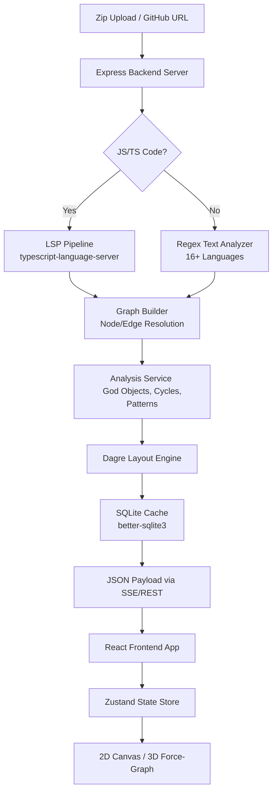

# 🏛️ Atlas

**Atlas** is an intelligent, automated Architecture Visualization and AI Analysis tool for modern multi-language codebases.

Instead of reading thousands of lines of raw code to deduce interactions, Atlas parses your repository, extracts its entities (Classes, Interfaces, Functions, Database Tables), computes relationships, detects anti-patterns (God Objects, Circular Dependencies, Dead Code), identifies architectural designs (Factories, Observers, Singletons), and renders it all in an interactive, sleek 2D canvas or a stunning 3D WebGL force-directed graph.

---

## 🏗️ System Architecture

Atlas operates as a monorepo containing a high-speed Express/TypeScript backend running an LSP (Language Server Protocol) indexer and a modern Next.js client-side SPA.



---

## ✨ Features

- 🌐 **3D Force-Directed Graph**: Seamlessly toggle between a standard 2D view (React Flow) and an interactive 3D WebGL canvas (Three.js). Features animated directional particle flows, emissive glowing node highlights for entry points and God Objects, and manual camera focus-zoom controls.
- 🎨 **Multi-Language Brand Colorization**: Support for JS/TS, Python, Go, Rust, Java, Kotlin, Swift, C/C++, C#, Ruby, PHP, SQL, and Prisma. Nodes are custom-badged by language type and dynamically color-coded matching their brand palettes.
- 🔍 **Interactive Code Peek**: Click any file, class, method, or database schema node to trigger a syntax-highlighted slide-out drawer showing its source code.
- 🚨 **Anti-Pattern Detection**: Instantly warns you about God Objects (bloated components), Circular Dependencies, and potentially Dead / Unused Code.
- 🧩 **Design Pattern Detection**: Heuristic analysis identifies Factory, Singleton, Observer, Builder, Strategy, and Adapter patterns in the codebase.
- 🎯 **Spotlight Search (Cmd+K)**: Apple Spotlight-style search command palette with fuzzy matching for classes, functions, files, and packages, including keyboard navigation.
- 🦟 **Bug Hunter Tab**: Smart heuristic-based bug localization using PageRank-style degree analysis and spreading activation on the dependency graph to pinpoint hotspots.
- 🔥 **Complexity Heatmaps**: Dynamically color-code nodes on the canvas based on their cyclomatic complexity (green/teal → orange/red).
- ⚡ **SQLite Caching & Intelligent Invalidation**: Backend uses `better-sqlite3` and `git ls-remote HEAD` cache checking. Subsequent loads of the same repository version are instantaneous.
- 📋 **Mermaid & JSON Exports**: Export your codebase's architectural relationships as Markdown-compatible Mermaid flowchart diagrams or download raw graph JSON structure files.
- 🐙 **1-Click GitHub Loading**: Pull and visualize any public (or private) GitHub repository simply by pasting its URL directly into the engine, powered by `simple-git`.
- 📁 **Zero-Configuration Zip Uploads**: Drag and drop codebase `.zip` archives directly onto the canvas for secure backend extraction and visualization.

---

## 🚀 Getting Started

Atlas uses a monorepo architecture divided between a Node.js/TypeScript backend running `typescript-language-server` and falling back on text-based regex parsers, and a React + Next.js frontend.

### Prerequisites
- Node.js (v18+ recommended)
- `npm` or `yarn`
- `git` installed globally (for repository cloning)

### Run Everything in One Command (Recommended)

You can spin up both the backend server and the frontend client concurrently with a single command from the root directory:

```bash
npm run dev
```

*This will start the backend API on `http://localhost:4000` and the Next.js frontend on `http://localhost:3000`.*

---

### Running Services Separately (Alternative)

If you prefer to run the services individually:

#### 1. Run the Backend Server
The backend parses AST structures and manages rate-controlled external integrations.
```bash
cd backend
npm install
npm run dev
```
*The API will start on `http://localhost:4000`*

#### 2. Run the Frontend App
The UI dashboard built using Next.js, MUI, and Vanilla CSS with glassmorphic elements.
```bash
cd frontend
npm install
npm run dev
```
*The Web App will run on `http://localhost:3000`*

---

## 📚 Core API Reference

The backend operates over a rapid REST + SSE architecture:

- `GET /api/health`: Validates server allocation and rate-limit availability.
- `POST /api/analyze/upload`: Accepts `multipart/form-data` containing a `.zip` repository. Automatically extracts and indexes the directory.
- `POST /api/analyze/github`: Provide JSON `{ "url": "https://github.com/user/repo" }`. Clones and indexes the repository.
- `GET /api/analyze/progress`: Server-Sent Events (SSE) endpoint to stream cloning, parsing, and layout updates.
- `GET /api/code`: Fetches the source code of a specific file inside a repository clone with directory traversal security checks.

---

## 🤝 Contributing

Contributions are absolutely welcome to help push codebase visualization bounds.

1. **Fork the repo** and clone it locally.
2. **Create a feature branch** (`git checkout -b feature/EpicVisualization`).
3. **Commit your changes** (`git commit -m 'Added incredible new design pattern inference'`).
4. **Push to the branch** (`git push origin feature/EpicVisualization`).
5. **Open a Pull Request**! Ensure both frontend UI adjustments and backend parser updates match existing architectural styling in `globals.css` and `types.ts`!

---

## 📜 License

Atlas is completely open-source and free to utilize under the MIT License. Go untangle those codebases!

