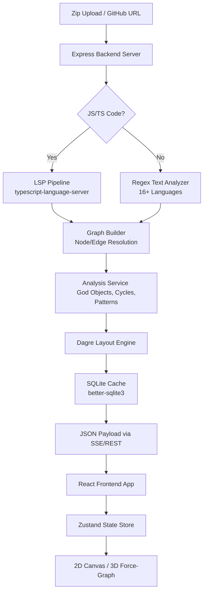

# 🏛️ Atlas

**Atlas** is an intelligent, automated Architecture Visualization and AI Analysis tool for modern multi-language codebases.

Instead of reading thousands of lines of raw code to deduce interactions, Atlas parses your repository, extracts its entities (Classes, Interfaces, Functions, Database Tables), computes relationships, detects anti-patterns (God Objects, Circular Dependencies, Dead Code), identifies architectural designs (Factories, Observers, Singletons), and renders it all in an interactive, sleek 2D canvas or a stunning 3D WebGL force-directed graph.

---

## 🏗️ System Architecture

Atlas operates as a monorepo containing a high-speed Express/TypeScript backend running an LSP (Language Server Protocol) indexer and a modern Next.js client-side SPA.



---

## ✨ Features

- 🌐 **3D Force-Directed Graph**: Seamlessly toggle between a standard 2D view (React Flow) and an interactive 3D WebGL canvas (Three.js). Features animated directional particle flows, emissive glowing node highlights for entry points and God Objects, and manual camera focus-zoom controls.
- 🎨 **Multi-Language Brand Colorization**: Support for JS/TS, Python, Go, Rust, Java, Kotlin, Swift, C/C++, C#, Ruby, PHP, SQL, and Prisma. Nodes are custom-badged by language type and dynamically color-coded matching their brand palettes.
- 🔍 **Interactive Code Peek**: Click any file, class, method, or database schema node to trigger a syntax-highlighted slide-out drawer showing its source code.
- 🚨 **Anti-Pattern Detection**: Instantly warns you about God Objects (bloated components), Circular Dependencies, and potentially Dead / Unused Code.
- 🧩 **Design Pattern Detection**: Heuristic analysis identifies Factory, Singleton, Observer, Builder, Strategy, and Adapter patterns in the codebase.
- 🎯 **Spotlight Search (Cmd+K)**: Apple Spotlight-style search command palette with fuzzy matching for classes, functions, files, and packages, including keyboard navigation.
- 🦟 **Bug Hunter Tab**: Smart heuristic-based bug localization using PageRank-style degree analysis and spreading activation on the dependency graph to pinpoint hotspots.
- 🔥 **Complexity Heatmaps**: Dynamically color-code nodes on the canvas based on their cyclomatic complexity (green/teal → orange/red).
- ⚡ **SQLite Caching & Intelligent Invalidation**: Backend uses `better-sqlite3` and `git ls-remote HEAD` cache checking. Subsequent loads of the same repository version are instantaneous.
- 📋 **Mermaid & JSON Exports**: Export your codebase's architectural relationships as Markdown-compatible Mermaid flowchart diagrams or download raw graph JSON structure files.
- 🐙 **1-Click GitHub Loading**: Pull and visualize any public (or private) GitHub repository simply by pasting its URL directly into the engine, powered by `simple-git`.
- 📁 **Zero-Configuration Zip Uploads**: Drag and drop codebase `.zip` archives directly onto the canvas for secure backend extraction and visualization.

---

## 🚀 Getting Started

Atlas is an npm-workspaces monorepo: a Node.js/TypeScript backend running `typescript-language-server` (with text-based parsers as a fallback), and a React + Next.js frontend.

### Prerequisites
- Node.js v20+ (v22 recommended — the CI uses 22)
- `npm`
- `git` installed globally, and reachable on `PATH` (used for cloning and for cache freshness checks)

### Install

Install once from the repository root — the workspaces handle both packages:

```bash
npm install
```

### Run Everything in One Command (Recommended)

```bash
npm run dev
```

*Backend API on `http://localhost:4000`, Next.js frontend on `http://localhost:3000`.*

### Running Services Separately (Alternative)

```bash
# Terminal 1 — backend (tsx watch)
npm run dev -w backend

# Terminal 2 — frontend
npm run dev -w frontend
```

### Production

```bash
npm run build     # compiles the backend to backend/dist and builds the Next.js app
npm start         # runs the compiled backend + the Next.js production server
```

The backend `start` script runs `node dist/backend/src/server.js` — it does **not** use `tsx` in production.

### Useful scripts

| Command | What it does |
|---|---|
| `npm run dev` | Both services in watch mode |
| `npm run build` | Build both workspaces |
| `npm start` | Build, then run both in production mode |
| `npm test -w backend` | Backend unit tests (vitest) |
| `npm test -w frontend` | Frontend store/selector tests |
| `npm run typecheck -w backend` | `tsc --noEmit` |
| `npm run lint -w frontend` | ESLint |
| `npm run cli -w backend -- parse <dir>` | Analyze a local directory and print the graph as JSON |

---

## ⚙️ Configuration

Copy the examples and adjust as needed:

```bash
cp backend/.env.example backend/.env
cp frontend/.env.example frontend/.env
```

### Backend (`backend/.env`)

| Variable | Default | Purpose |
|---|---|---|
| `PORT` | `4000` | API port |
| `HOST` | `127.0.0.1` | Bind address. The API is loopback-only by default because it clones arbitrary repositories and serves file contents **with no authentication**. Set `0.0.0.0` only if you deliberately expose it. |
| `ALLOWED_ORIGINS` | *(none)* | Comma-separated browser origins allowed to call the API directly. Only needed when the frontend runs with `NEXT_PUBLIC_USE_PROXY=false`. `*` allows any origin (not recommended). |
| `TRUST_PROXY_HOPS` | `0` | Number of reverse proxies in front of the server. Required for per-IP rate limiting to work behind a tunnel or nginx. Never set higher than the real hop count — clients could otherwise spoof `X-Forwarded-For`. |
| `ATLAS_DB_PATH` | `~/.atlas/cache.db` | SQLite cache location |
| `GITHUB_TOKEN` | *(none)* | Optional PAT for cloning private repositories. Sent as an HTTP header, never embedded in the remote URL. |

**Resource limits**

| Variable | Default | Purpose |
|---|---|---|
| `ATLAS_MAX_CONCURRENT_ANALYSES` | `1` | Analyses allowed to run at once. Each spawns a language server, so raising this on a small host risks OOM. |
| `ATLAS_QUEUE_TIMEOUT_MS` | `600000` | How long a queued request waits for a slot |
| `ATLAS_CLONE_MAX_AGE_MS` | `86400000` | Evict clone workspaces older than this (24h) |
| `ATLAS_CLONE_MAX_BYTES` | `2147483648` | Total disk budget across all workspaces (2 GiB) |
| `ATLAS_CLONE_SWEEP_MS` | `3600000` | How often the eviction sweep runs |

Cloned repositories are kept under `~/.atlas/clones` after analysis so Code Peek can read source files, and are evicted by age and then by total size.

**AI assistant** — API keys are supplied per request by the browser and are never stored server-side. Only model selection is configured here.

| Variable | Default |
|---|---|
| `ATLAS_OPENAI_MODEL` | `gpt-4o` |
| `ATLAS_ANTHROPIC_MODEL` | `claude-sonnet-5` |
| `ATLAS_GEMINI_MODEL` | `gemini-2.0-flash` |
| `ATLAS_AI_MAX_TOKENS` | `8192` |
| `ATLAS_AI_TIMEOUT_MS` | `120000` |

### Frontend (`frontend/.env`)

| Variable | Default | Purpose |
|---|---|---|
| `BACKEND_URL` | `http://localhost:4000` | Backend address used by the Next.js server-side proxy routes |
| `NEXT_PUBLIC_BACKEND_URL` | `http://localhost:4000` | Backend address used by the browser when the proxy is disabled |
| `NEXT_PUBLIC_USE_PROXY` | `true` | Route API calls through Next.js instead of hitting the backend directly. Keep this on unless you have a reason not to — it is what lets the backend stay loopback-only. |
| `PORT` | `3000` | Frontend port |

---

## 📚 Core API Reference

The backend serves REST + SSE under `/api`. Every route is also reachable through the Next.js proxy on port 3000 at the same path.

### Analysis

- `POST /api/analyze/upload` — `multipart/form-data` with a `file` field containing a `.zip`, plus an optional `sessionId` for progress streaming. Extracted with Zip-Slip and symlink protection.
- `POST /api/analyze/github` — JSON `{ "url": "https://github.com/user/repo", "sessionId": "..." }`. Clones (depth 1) and indexes the repository.
- `GET /api/analyze/github/cached?repoId=owner/repo` — returns a cached analysis only; `404` if absent. Never triggers work.
- `GET /api/analyze/progress?sessionId=...` — Server-Sent Events stream of cloning/parsing/layout progress.

All three analysis responses share one body, defined once in `shared/types.ts` as `AnalysisResponse`:

```jsonc
{
  "nodes": [...],           // React Flow nodes; `data.metadata` and `data.analysis` always present
  "edges": [...],           // `type` is the renderer, `relation` is import|extends|implements|calls
  "analysis": {             // godObjects, deadCode, cycles, patterns
    "godObjects": [], "deadCode": [], "cycles": [], "patterns": []
  },
  "godObjectDetails": [],
  "deadCodeDetails": [],
  "entryPoint": { "entryFile": "src/index.ts", "framework": "node" },
  "repoId": "owner/repo"
}
```

### Repository & source

- `GET /api/repos/recent` — the most recently analyzed repositories, for the landing page.
- `GET /api/code?repoId=owner/repo&filePath=src/x.ts` — source of one file inside a clone, for Code Peek. Paths are resolved through `realpath` and must stay inside the repository root, so symlinks in a cloned repo cannot escape it.

### AI assistant

These require two headers: `x-ai-provider` (`openai` | `anthropic` | `gemini`) and `x-ai-api-key`. The key is forwarded to the provider and never persisted.

- `POST /api/ai/chat` — JSON `{ message, repoUrl, history }`. Streams an SSE answer grounded in the repository's architecture graph and any source files named in the message.
- `POST /api/ai/fix-issue` — JSON `{ issue, repoUrl }`. Streams a suggested fix for a GitHub issue.
- `GET /api/ai/issues?repoUrl=...` — open issues for a public repository (pull requests filtered out).

### Health

- `GET /api/health` — `{ status, timestamp, analyses: { active, queued } }`.

---

## 🔒 Security notes

Atlas clones arbitrary repositories and serves file contents, and it ships **without authentication**. Before exposing it beyond localhost:

- Put an authenticating proxy in front of it, or keep `HOST=127.0.0.1` and let only the Next.js server reach it.
- Set `TRUST_PROXY_HOPS` so rate limiting counts real clients rather than the proxy.
- Set `ALLOWED_ORIGINS` explicitly rather than using `*`.

Cloned repositories are untrusted content. Path handling for both zip extraction and Code Peek goes through `backend/src/api/path-safety.ts`, which resolves symlinks before checking containment; add any new filesystem entry point there rather than writing a new check.

---

## 🤝 Contributing

Contributions are absolutely welcome to help push codebase visualization bounds.

1. **Fork the repo** and clone it locally.
2. **Create a feature branch** (`git checkout -b feature/EpicVisualization`).
3. **Make your change.** Before opening a PR, run what CI runs:
   ```bash
   npm run typecheck -w backend && npm run typecheck -w frontend
   npm run lint -w frontend
   npm test -w backend && npm test -w frontend
   npm run build
   ```
4. **Push to the branch** (`git push origin feature/EpicVisualization`).
5. **Open a Pull Request.**

### Conventions worth knowing

- **The API payload is defined once**, in `shared/types.ts` as `AnalysisResponse`. Both sides import it, so adding a field means adding it there first — never redeclare the shape locally. `runGraphPipeline` is typed against it so a missed field fails the build.
- **Filesystem paths from user input go through `backend/src/api/path-safety.ts`.** Cloned repositories are untrusted content. Don't hand-roll containment checks; extend that module and its tests instead.
- **Edge `type` is the React Flow renderer, `relation` is the architectural meaning** (`import` / `extends` / `implements` / `calls`). Filter on `relation`.
- UI styling follows the existing tokens in `globals.css`.

### Keeping your fork up to date

An upstream repository cannot push into its forks — syncing is always initiated from the fork side. Either:

- Use GitHub's **"Sync fork"** button on your fork's page, or run `gh repo sync <you>/Reverse-Architect`, **or**
- Automate it: copy [`.github/templates/sync-fork.yml`](.github/templates/sync-fork.yml) into your fork at `.github/workflows/sync-fork.yml`. It fast-forwards your default branch from upstream daily and can be run on demand. See the comments in that file — Actions must be enabled on your fork, and GitHub disables scheduled workflows on forks after 60 days of inactivity.

---

## 📜 License

Atlas is completely open-source and free to utilize under the MIT License. Go untangle those codebases!

